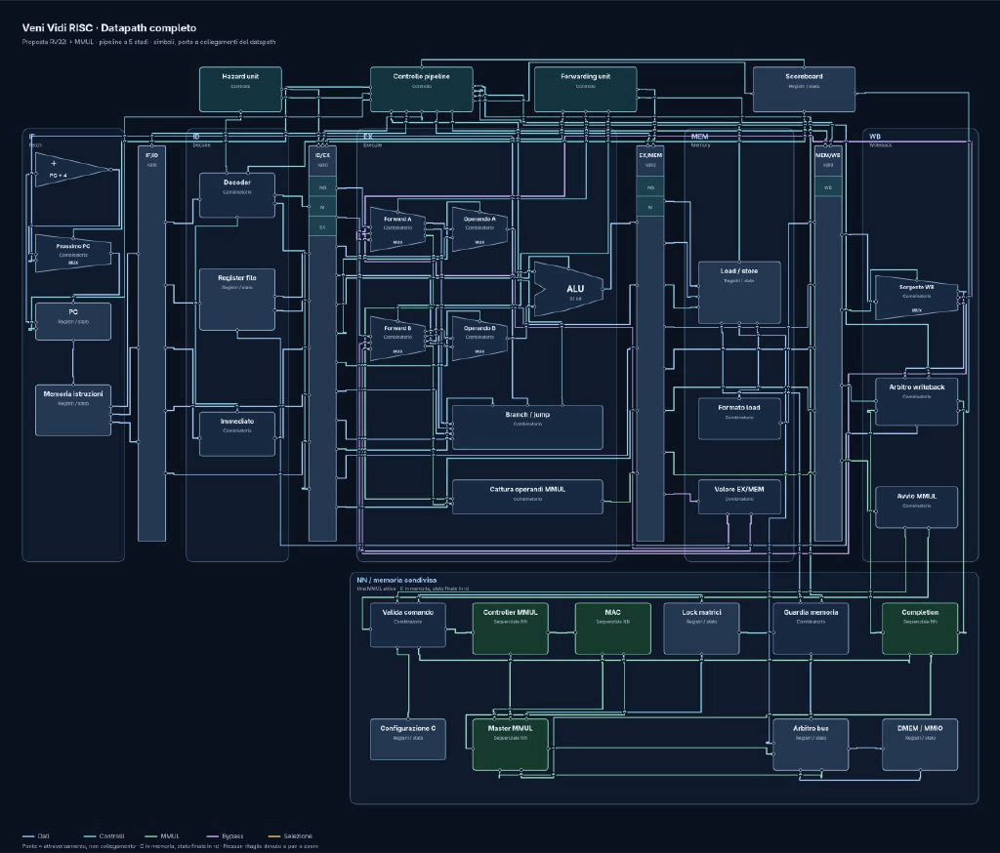

# Veni Vidi RISC

A RISC-V CPU with a hardware accelerator for neural-network matrix operations.

Developed by **Angelo Perotti** and **Michelangelo Calia** for the
**Advanced Logic Design** course at the **University of Trento (UniTrento)**.

## Project overview

The goal is to design a processor that combines a general-purpose RISC-V core
with a dedicated matrix-multiplication unit (MMUL) for neural-network workloads.
The CPU runs the program and launches matrix operations, while the accelerator
performs the computation using shared data memory. Independent CPU instructions
can continue while the accelerator is busy; a scoreboard tracks dependencies
and writeback arbitration coordinates completion.

## Planned architecture

- **RISC-V core:** a 32-bit RV32I processor with a five-stage pipeline
  (fetch, decode, execute, memory access, writeback).
- **Hazard handling:** hardware forwarding, stalls, and pipeline flushing.
- **Matrix accelerator:** an MMUL controller and multiply-accumulate (MAC)
  datapath, with operand capture and completion handling.
- **Dependency tracking:** a scoreboard and writeback arbiter to coordinate
  the CPU pipeline with accelerator results.
- **System integration:** instruction memory, shared data memory, memory-mapped
  peripherals, and bus arbitration with memory-access guards.
- **Verification:** simulation testbenches and software tests, followed by
  hardware validation.

## Datapath overview

The diagram shows the CPU pipeline at the top and the matrix accelerator and
shared-memory interface below. Forwarding and pipeline control handle CPU
hazards, while the scoreboard coordinates dependencies on accelerator results.
The bus arbiter and memory guards coordinate access to matrix data.

This is a **proposed architecture**, not a completed implementation. Blocks and
interfaces may change as the design develops.

## Status

The project is in early development. The architecture and supporting build
infrastructure are being established; the complete CPU and accelerator are
not implemented yet.

This README is a starting overview. Pipeline details, the accelerator
interface, build instructions, and results will be expanded as the project
progresses.

## License

Licensed under [CC BY-NC 4.0](LICENSE). See [NOTICE](NOTICE) for attribution
and licensing details.
